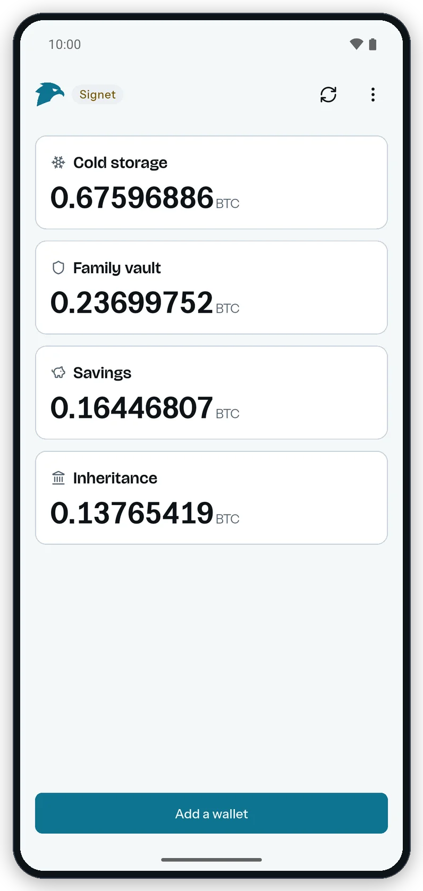
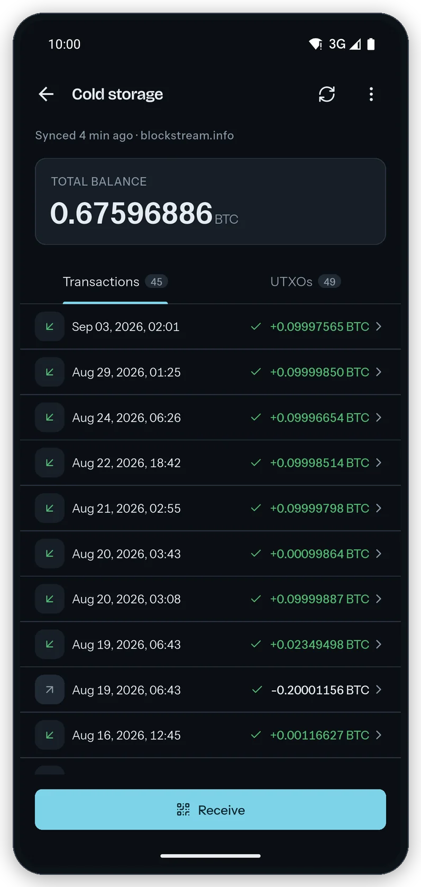
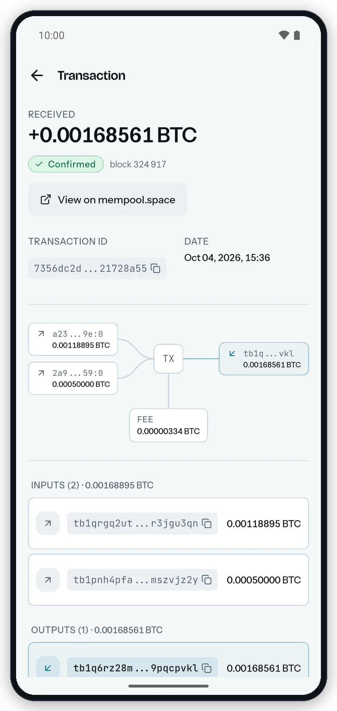
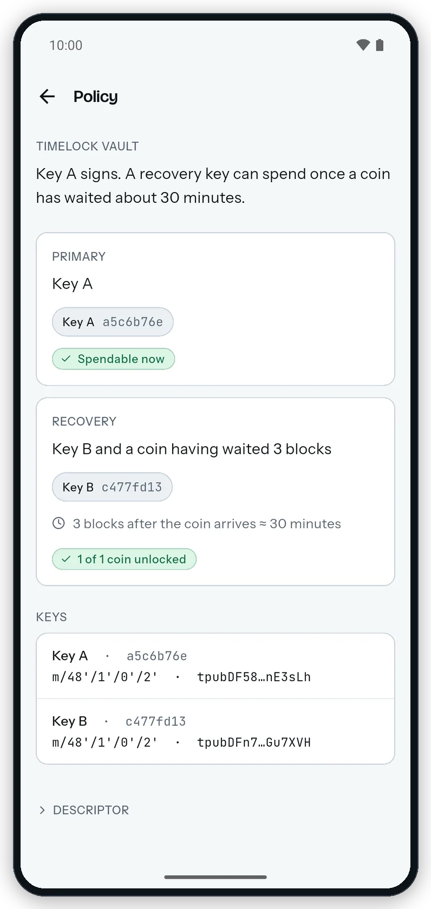

<div align="center">

<picture>
  <source media="(prefers-color-scheme: dark)" srcset=".github/images/logo-dark.svg">
  
</picture>

<h3>The Bitcoin watch-only wallet for Android</h3>

Follow every wallet you own from its descriptor or public key.<br>
Gerfaut holds no private keys, so it can never spend your bitcoin.

[Download](https://gerfaut-wallet.com/download#android) · [Documentation](https://gerfaut-wallet.com/docs) · [Website](https://gerfaut-wallet.com) · [Desktop app](https://github.com/gerfaut-wallet/gerfaut-desktop)

[](https://github.com/gerfaut-wallet/gerfaut-mobile/actions/workflows/ci.yml)
[](LICENSE)

</div>

<br>

<p align="center">
  
  
  
  
</p>

> [!NOTE]
> Gerfaut is in public beta. It cannot move your bitcoin, but it is new and has had little testing: check addresses and amounts on your signing device before you rely on them, and [open an issue](https://github.com/gerfaut-wallet/gerfaut-mobile/issues) when something looks wrong.

## Features

- Watch any wallet you already have: an output descriptor (Miniscript included), an xpub, ypub or zpub, a single address, a multisig setup, a BSMS record, or a Sparrow or Coldcard export. Paste it, open the file or scan the QR code, animated ones included.
- Get a notification when a transaction reaches the mempool, and another when it confirms, even after a reboot. They come through the backend you chose: there is no Gerfaut server and no Firebase.
- Add widgets to your home screen for the bitcoin price, your balances and the block height, with amounts hidden until you turn them on.
- Open a transaction to see its inputs, outputs and fee on one diagram, and find every UTXO in a list of its own.
- Read a Miniscript policy in plain words: each spending path, with its timelock counted down to the block or the date it opens.
- Connect to your own Electrum or Esplora server, or stay on a public one. An `.onion` backend needs no other app, because Gerfaut has a Tor client built in.
- Lock Gerfaut with a PIN or a password and open it with biometrics, or disguise it as a working calculator. Locked, Gerfaut blocks screenshots and blanks itself in the recent apps.
- Bring your wallets over from the [desktop app](https://github.com/gerfaut-wallet/gerfaut-desktop) by scanning the animated QR code of an encrypted backup.

Gerfaut works on mainnet, signet, testnet4 and regtest, in a light or a dark theme. There is no code to generate keys, handle seeds or sign transactions, and no Send button.

## Download

Gerfaut runs on Android 7.0 or newer. Get the APK for your phone's processor from the [latest release](https://github.com/gerfaut-wallet/gerfaut-mobile/releases/latest):

| File | For |
|---|---|
| `gerfaut-v<version>-android-arm64-v8a.apk` | Almost every phone sold since 2017. Take this one unless you know otherwise. |
| `gerfaut-v<version>-android-armeabi-v7a.apk` | Older 32-bit phones |
| `gerfaut-v<version>-android-x86_64.apk` | Emulators and Chromebooks |

Open the file on your phone and allow the install when Android asks. [Install on Android](https://gerfaut-wallet.com/docs/getting-started/install-android) walks through it, updates included.

### Verify your download

Every release ships a `SHA256SUMS` file signed with the author's [minisign](https://jedisct1.github.io/minisign/) key:

```
RWTz3c4gUmglCX5Uvjthigz1ts3TS3ZSdhRNpFgOJRW/Wr4XjGlqTR3O
```

Put `SHA256SUMS` and `SHA256SUMS.minisig` next to the APK, then run:

```sh
minisign -Vm SHA256SUMS -P RWTz3c4gUmglCX5Uvjthigz1ts3TS3ZSdhRNpFgOJRW/Wr4XjGlqTR3O
sha256sum --check SHA256SUMS --ignore-missing   # macOS: shasum -a 256 --check SHA256SUMS --ignore-missing
```

The first command proves the list comes from the author, the second that your file matches it. For Windows, see [Verify a download](https://gerfaut-wallet.com/docs/getting-started/verify-your-download).

Every APK is signed with the same certificate. `apksigner verify --print-certs`, from the Android SDK build tools, must print this SHA-256 digest:

```
de91a0e0c151290a0c9b34507e58d0bd0e99cdd7db41adc65b60a7c68e0ff0a7
```

## Build from source

You need git, Flutter, [rustup](https://rustup.rs) and the Android SDK with the NDK that Flutter asks for. The versions CI uses are pinned: Flutter in `.github/workflows/ci.yml`, Rust and its three Android targets in `rust/rust-toolchain.toml`.

The app builds [gerfaut-core](https://github.com/gerfaut-wallet/gerfaut-core) from the folder next to its own, at the revision `reproducible/gerfaut-core.rev` names:

```sh
git clone https://github.com/gerfaut-wallet/gerfaut-mobile
git clone https://github.com/gerfaut-wallet/gerfaut-core
git -C gerfaut-core checkout "$(cat gerfaut-mobile/reproducible/gerfaut-core.rev)"
cd gerfaut-mobile
flutter build apk --debug   # build/app/outputs/flutter-apk/app-debug.apk
```

Release APKs come out of the pinned container in `reproducible/`. To build the three unsigned APKs the way the release workflow does, run `reproducible/build.sh`, which needs git and Docker.

## Contributing

Bug reports and pull requests are welcome. Open an issue before any change beyond a small fix, and read [CONTRIBUTING.md](CONTRIBUTING.md) first: it explains the license of contributions, how to regenerate the Rust bridge, and the one hard rule, which is that Gerfaut stays watch-only. Before you push, run what CI runs:

```sh
dart format --output=none --set-exit-if-changed lib test
flutter analyze
flutter test
cd rust && cargo fmt --check && cargo clippy --all-targets -- -D warnings && cargo test
```

## Security

Do not report a vulnerability in a public issue. Use [private vulnerability reporting](https://github.com/gerfaut-wallet/gerfaut-mobile/security/advisories/new) or write to info@pandul.fr. [SECURITY.md](SECURITY.md) lists what is in scope and what to expect.

## License

Gerfaut is free software under the [GNU Affero General Public License v3.0 only](LICENSE). For a commercial license, write to info@pandul.fr.

The Gerfaut name and logo are not covered by the code license. See [TRADEMARK.md](TRADEMARK.md).
